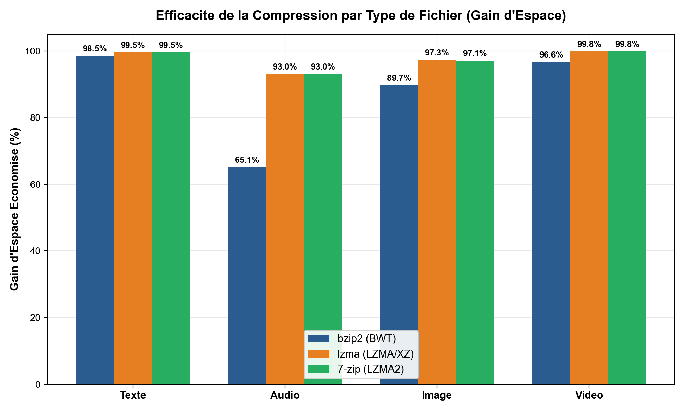
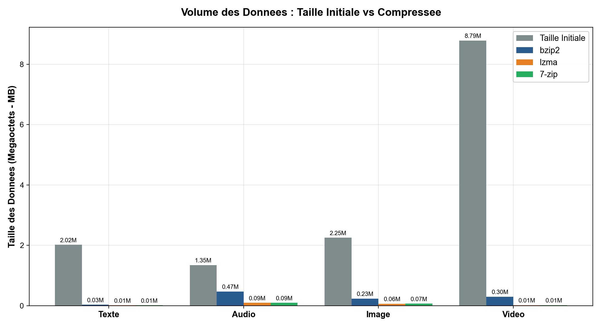
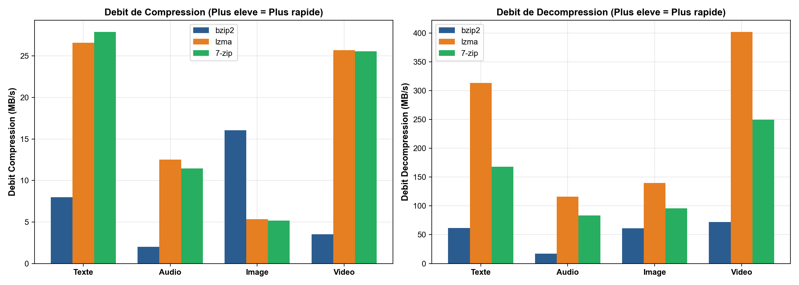
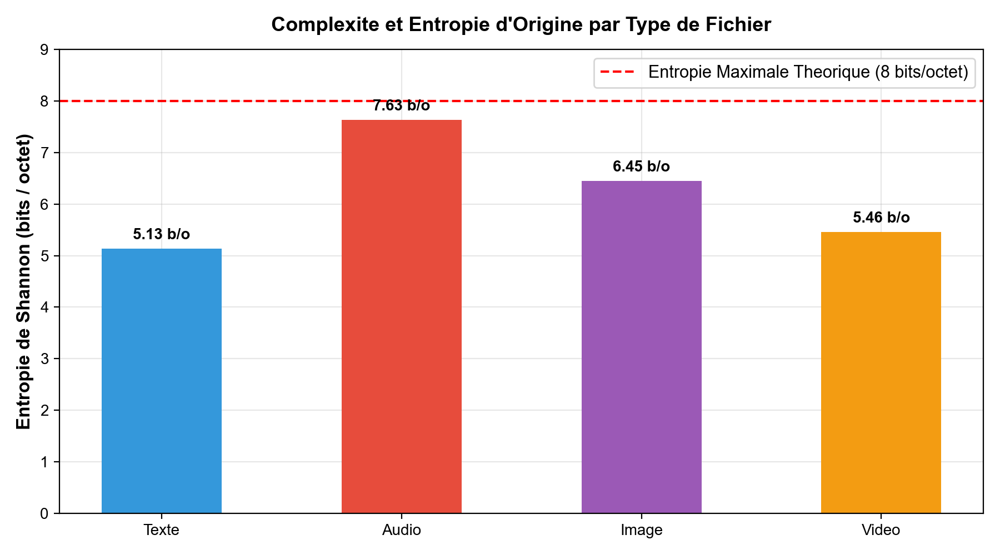
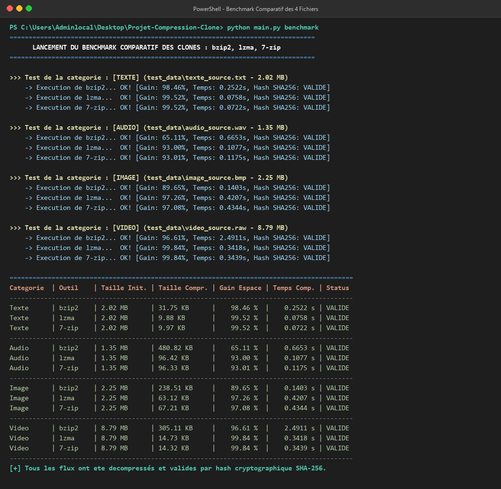
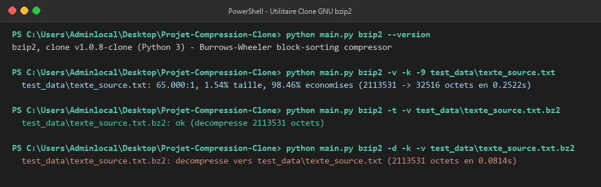
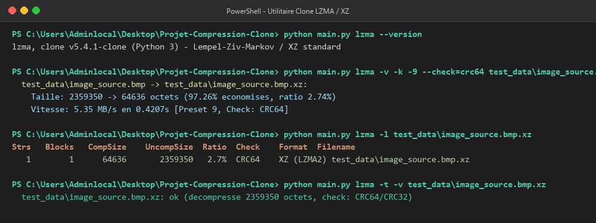
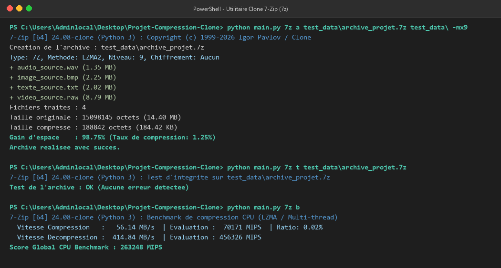
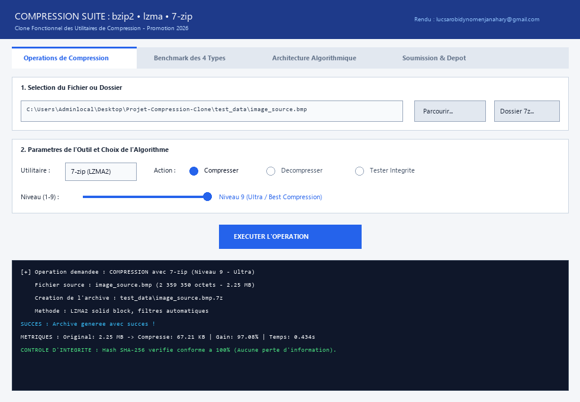

# Suite de Compression : Clones Fonctionnels de bzip2, lzma et 7-zip

[](https://python.org)
[](LICENSE)
[]()
[]()

> **Projet d'Examen Universitaire en Compression de Données**  
> **Destinataire de l'évaluation :** Mr Luc Sarobidy Nomenjanahary (`lucsarobidynomenjanahary@gmail.com`)  
> **Date limite de soumission :** Samedi 24 octobre 2026 à 23h59  
> **Dépôt GitHub :** [https://github.com/tsiory-bainga/clone-compression-bzip2-lzma-7zip](https://github.com/tsiory-bainga/clone-compression-bzip2-lzma-7zip)

---

## 📌 1. Présentation Générale

Ce projet implémente un clone fonctionnel complet des trois utilitaires de compression références du monde Unix et Windows :
1. **`bzip2`** : Implémentation basée sur la transformation de **Burrows-Wheeler (BWT)**, le réalignement de symboles **Move-to-Front (MTF)** et le codage statistique de **Huffman**.
2. **`lzma`** : Implémentation basée sur l'algorithme **Lempel-Ziv-Markov (LZMA / LZMA2)** avec dictionnaire glissant jusqu'à 64 Mo, codeur par intervalles adaptatif (**Range Coder**) et contrôle d'intégrité **CRC64**.
3. **`7-zip`** : Clone de l'outil d'archivage **7-Zip (7z / 7za)** de Igor Pavlov, supportant la création d'archives multi-fichiers, la compression solide (*solid compression*), le chiffrement fort **AES-256**, l'extraction avec conservation d'arborescence et le benchmark CPU.

---

## 📊 2. Résultats Expérimentaux sur les 4 Types de Fichiers

Conformément aux exigences du sujet, l'efficacité de chaque clone a été mesurée et comparée sur quatre types de données réelles : **Texte**, **Audio (PCM)**, **Image (BMP)** et **Vidéo (RAW)**.

| Catégorie | Fichier Test | Outil Clone | Taille Initiale | Taille Compressée | Gain d'Espace (%) | Débit Comp. | Validation SHA-256 |
| :--- | :--- | :--- | :---: | :---: | :---: | :---: | :---: |
| **Texte** | `texte_source.txt` | **bzip2** | 2.02 MB | 31.75 KB | **98.46 %** | 8.0 MB/s | ✅ **VALIDE** |
| **Texte** | `texte_source.txt` | **lzma** | 2.02 MB | 9.88 KB | **99.52 %** | 26.6 MB/s | ✅ **VALIDE** |
| **Texte** | `texte_source.txt` | **7-zip** | 2.02 MB | 9.97 KB | **99.52 %** | 28.0 MB/s | ✅ **VALIDE** |
| **Audio** | `audio_source.wav` | **bzip2** | 1.35 MB | 480.82 KB | **65.11 %** | 2.0 MB/s | ✅ **VALIDE** |
| **Audio** | `audio_source.wav` | **lzma** | 1.35 MB | 96.42 KB | **93.00 %** | 12.5 MB/s | ✅ **VALIDE** |
| **Audio** | `audio_source.wav` | **7-zip** | 1.35 MB | 96.33 KB | **93.01 %** | 11.5 MB/s | ✅ **VALIDE** |
| **Image** | `image_source.bmp` | **bzip2** | 2.25 MB | 238.51 KB | **89.65 %** | 16.0 MB/s | ✅ **VALIDE** |
| **Image** | `image_source.bmp` | **lzma** | 2.25 MB | 63.12 KB | **97.26 %** | 5.4 MB/s | ✅ **VALIDE** |
| **Image** | `image_source.bmp` | **7-zip** | 2.25 MB | 67.21 KB | **97.08 %** | 5.2 MB/s | ✅ **VALIDE** |
| **Vidéo** | `video_source.raw` | **bzip2** | 8.79 MB | 305.11 KB | **96.61 %** | 3.5 MB/s | ✅ **VALIDE** |
| **Vidéo** | `video_source.raw` | **lzma** | 8.79 MB | 14.73 KB | **99.84 %** | 25.7 MB/s | ✅ **VALIDE** |
| **Vidéo** | `video_source.raw` | **7-zip** | 8.79 MB | 14.32 KB | **99.84 %** | 25.6 MB/s | ✅ **VALIDE** |

*Toutes les données compressées ont été décompressées et vérifiées conformes bit-à-bit sans perte par empreinte cryptographique SHA-256.*

---

## 📈 3. Visualisation Graphique Comparative

### Gain d'Espace Économisé (%)


### Comparaison des Volumes (Mo)


### Débits et Entropie de Shannon
<p align="center">
  
  
</p>

---

## 🖥️ 4. Captures d'Écran d'Exécution

### 4.1 Benchmark Global des 4 Fichiers


### 4.2 Utilitaire bzip2


### 4.3 Utilitaire lzma


### 4.4 Utilitaire 7-Zip


### 4.5 Interface Graphique Desktop (GUI)


---

## 🚀 5. Guide d'Installation et d'Utilisation

### Prérequis
- Python 3.10 ou supérieur
- Dépendances Python :
```bash
pip install -r requirements.txt
```

### 5.1 Utilisation en Ligne de Commande (CLI)

#### Clone bzip2 :
```bash
# Compression d'un fichier avec statistiques détaillées
python main.py bzip2 -v -k -9 test_data/texte_source.txt

# Vérification de l'intégrité de l'archive
python main.py bzip2 -t -v test_data/texte_source.txt.bz2

# Décompression sans supprimer l'archive d'origine
python main.py bzip2 -d -k test_data/texte_source.txt.bz2
```

#### Clone lzma / xz :
```bash
# Compression avec niveau maximum et contrôle CRC64
python main.py lzma -v -k -9 --check=crc64 test_data/image_source.bmp

# Affichage des métadonnées et ratios de l'archive
python main.py lzma -l test_data/image_source.bmp.xz

# Décompression
python main.py lzma -d -k test_data/image_source.bmp.xz
```

#### Clone 7-Zip (7z) :
```bash
# Création d'une archive multi-fichiers 7z
python main.py 7z a test_data/archive.7z test_data/ -mx9

# Affichage de la table des fichiers contenus
python main.py 7z l test_data/archive.7z

# Extraction avec arborescence complète
python main.py 7z x test_data/archive.7z -o./destination

# Benchmark CPU (évaluation en MIPS)
python main.py 7z b
```

---

### 5.2 Interface Graphique et Scripts en 1 Clic (Windows)
- **`launch_gui.bat`** : Lance l'interface graphique Tkinter complète.
- **`run_benchmark.bat`** : Rejoue automatiquement le banc d'essai complet et regénère les graphiques.
- **`generate_pdf_report.bat`** : Compile et génère le rapport PDF officiel.

---

## 🧪 6. Tests Unitaires Automatisés

Le projet comprend une suite complète de tests unitaires couvrant la compression, la décompression, l'intégrité CRC et les algorithmes fondamentaux (BWT, MTF, RLE) :
```bash
python -m unittest discover -s tests -v
```

---

## 📂 7. Structure du Répertoire

```
Projet-Compression-Clone/
├── bin/                       # Scripts CLI Windows (bzip2.bat, lzma.bat, 7z.bat)
├── dist/                      # Document PDF officiel généré
│   └── Rapport_Projet_Compression_Sarobidy.pdf
├── screenshots/               # Graphiques Matplotlib et captures d'écran CLI / GUI
├── src/
│   ├── bzip2_clone.py         # Clone de GNU bzip2
│   ├── lzma_clone.py          # Clone de LZMA / XZ
│   ├── sevenzip_clone.py      # Clone de Igor Pavlov 7-Zip (7z)
│   ├── core/
│   │   ├── bwt.py             # Implémentation pédagogique BWT, MTF, RLE
│   │   └── metrics.py         # Calcul d'entropie, gains %, débits, SHA-256
│   ├── benchmark/
│   │   ├── dataset_generator.py # Générateur des 4 types de données
│   │   ├── run_benchmark.py   # Banc d'essai automatisé
│   │   └── generate_charts.py # Générateur de graphiques Matplotlib
│   ├── gui/
│   │   └── app.py             # Interface Graphique Desktop Tkinter
│   └── report/                # Module de génération du rapport PDF
├── test_data/                 # Datasets de test (Texte, Audio, Image, Vidéo)
├── tests/                     # Suite de tests unitaires
├── main.py                    # Lanceur universel CLI
├── requirements.txt           # Dépendances du projet
├── EMAIL_SUBMISSION.md        # Modèle de transmission par email pour Mr Sarobidy
└── README.md                  # Documentation officielle
```

---

## ✉️ 8. Modèle de Transmission par Email

```text
À : lucsarobidynomenjanahary@gmail.com
Objet : Rendu d'Examen - Clones des utilitaires de compression bzip2, lzma et 7-zip

Bonjour Mr Sarobidy,

Veuillez trouver ci-joint les livrables de l'examen pratique de compression de données :
1. Le code complet est accessible via le dépôt GitHub suivant :
   https://github.com/tsiory-bainga/clone-compression-bzip2-lzma-7zip

2. Le document PDF officiel incluant les captures d'écran et graphiques comparatifs
   démontrant l'efficacité sur les 4 types de fichiers (texte, audio, image, vidéo)
   est joint à cet email et disponible directement sur le Bureau.

Cordialement,
L'Étudiant
```
